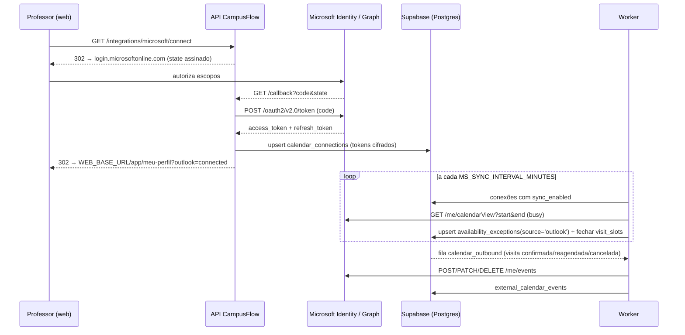

# Sprint 2 — Integração Outlook e Agenda Avançada

> Prioridade: **Alta / Média**. Fonte: relatório de análise funcional do CampusFlow, seção 6 (roadmap), tabela 4.3 e recomendações da seção 5 (Microsoft Graph API, Cron de validade, Object Storage).
> Pressupõe a Sprint 1 concluída (em especial: componente `Drawer`, `PATCH /auth/me`, bucket `avatars`, colunas `behavioral_test_*` em `promoter_profiles`).

## Sumário

1. [Objetivo e escopo](#1-objetivo-e-escopo)
2. [Estado atual do código (achados)](#2-estado-atual-do-código-achados)
3. [Pré-requisitos e convenções](#3-pré-requisitos-e-convenções)
4. [E1 — Integração OAuth 2.0 com Microsoft Outlook (Professor)](#4-e1--integração-oauth-20-com-microsoft-outlook)
5. [E2 — Calendário visual estilo Google Calendar para promotores, com fotos](#5-e2--calendário-visual-para-promotores-com-fotos)
6. [E3 — Cron de validade semestral do teste comportamental](#6-e3--cron-de-validade-semestral-do-teste-comportamental)
7. [E4 — Ajustes no painel do professor: data/hora em destaque e remoção de redundância](#7-e4--painel-do-professor-datahora-em-destaque)
8. [Ordem de execução sugerida](#8-ordem-de-execução-sugerida)
9. [Checklist de encerramento da sprint](#9-checklist-de-encerramento-da-sprint)
10. [Riscos e decisões em aberto](#10-riscos-e-decisões-em-aberto)

---

## 1. Objetivo e escopo

- Professor conecta sua conta Microsoft; o CampusFlow **lê a disponibilidade (free/busy)** para bloquear horários automaticamente e **cria/atualiza/remove eventos** no Outlook quando uma visita é confirmada, reagendada ou cancelada.
- Promotor ganha uma **agenda semanal visual** (estilo Google Calendar) com as visitas, acesso rápido ao briefing e **upload de fotos da visita** (armazenadas em Supabase Storage).
- **Cron diário** que verifica `behavioral_test_expires_at`, avisa com 15 dias de antecedência e marca o teste como vencido (retirando o promotor do match até refazer o questionário).
- Painel do professor: destacar data/hora da visita, remover a exibição redundante do próprio professor e sinalizar sincronização com Outlook.

Fora do escopo: edição de dados cadastrais do professor, temas e refinamento estético completo (Sprint 3).

---

## 2. Estado atual do código (achados)

### Integrações e jobs

- **Não existe** nenhum código Microsoft/Outlook/OAuth/MSAL no repositório. Único "Graph" presente é a Meta Graph API do WhatsApp ([apps/api/src/integrations/whatsapp/whatsapp.client.ts](../../apps/api/src/integrations/whatsapp/whatsapp.client.ts)).
- Variáveis de ambiente validadas em [apps/api/src/config/env.ts](../../apps/api/src/config/env.ts) (zod). Já existem `WEB_BASE_URL` e `API_BASE_URL`, úteis para o redirect do OAuth.
- Filas: **pgmq** (`messages_outbound`, `rubeus_outbound` em [packages/shared/src/constants.ts](../../packages/shared/src/constants.ts)); wrappers SQL `queue_send/queue_read/queue_archive/queue_delete` ([0006_messaging.sql](../../supabase/migrations/0006_messaging.sql) ~332–367).
- Worker Node único: [apps/api/src/jobs/worker.ts](../../apps/api/src/jobs/worker.ts) — loop com `setTimeout(env.QUEUE_POLL_INTERVAL_MS)`; a cada tick chama `promote_due_message_jobs`, `expire_pending_invitations`, lê as duas filas e envia WhatsApp/SendGrid. Sobe com `npm run dev:worker` ou `npm run dev:full`.
- **pg_cron** já é usado: `promote-message-jobs` (0006), `mark-no-shows`, `refresh-mv-*` (0008), `expire-invitations`, `mark-absent-visits`, `alert-unattended-visits` (0016). Padrão: `select cron.schedule('nome', '<cron>', $$ select public.fn(); $$);`.
- `admin_alerts` ([0013_match.sql](../../supabase/migrations/0013_match.sql) ~22–31) com enum `alert_kind` = `no_substitute, visit_unattended, professor_required_missing, invitation_expiring, schedule_conflict` ([0010](../../supabase/migrations/0010_pivot_rename.sql) ~232). **Nenhuma rota da API** lê ou resolve `admin_alerts` (grep vazio em `apps/api/src`).
- Notificações a participantes: `schedule_visit_communications(p_visit_id, p_trigger)` ([0010](../../supabase/migrations/0010_pivot_rename.sql) ~663–747) cobre candidato e promotor; **não há ramo `audience = 'professor'`**, embora o CHECK de `communication_rules.audience` já aceite `'professor'` (0015). Envio físico: fila → worker → `sendEmail` ([sendgrid.client.ts](../../apps/api/src/integrations/sendgrid/sendgrid.client.ts)) / `sendTemplate|sendText` (WhatsApp).

### Calendário e disponibilidade

- `calendar_events`: `id, tenant_id, visit_id (unique), promoter_id, professor_id, title, description, starts_at, ends_at, confirmed_*, declined_*, created_at, updated_at`. Trigger `create_calendar_event_for_visit` (0010 ~343–368) cria o evento quando a visita nasce com `promoter_id`; `schedule_visit_with_match` ajusta `promoter_id/professor_id`; `assign_visit_manually` atualiza o evento.
- `GET /calendar/events` (admin, promotor, professor; promotor/professor só veem os próprios) em [calendar.service.ts](../../apps/api/src/modules/calendar/calendar.service.ts); `GET /calendar/events/:id/ics` já exporta ICS.
- Disponibilidade: `availability_rules` (semanal), `availability_exceptions` (`kind: block | extra | last_minute`), `visit_slots` (`owner_id, owner_role, starts_at, ends_at, capacity, booked_count, is_open`). `generate_visit_slots(p_tenant_id, p_from, p_to, p_owner_id)` ([0010](../../supabase/migrations/0010_pivot_rename.sql) ~510–583) pula intervalos com exceções `block/last_minute`, mas **não fecha slots já gerados** quando uma exceção nova é inserida. Rotas em [availability.routes.ts](../../apps/api/src/modules/availability/availability.routes.ts) (`GET/PUT /rules`, `GET/POST /exceptions`, `DELETE /exceptions/:id`).
- [AvailabilityPage.tsx](../../apps/web/src/features/availability/AvailabilityPage.tsx): edita regras e gera slots (30 dias); **sem UI de exceções**.
- `find_available_professor` ([0014](../../supabase/migrations/0014_visits_invitations.sql) ~209–248) exige slot de professor aberto que **contenha** a janela e nenhuma visita conflitante.

### Promotor e visitas

- Promotor vê visitas em lista ([MyVisitsPage](../../apps/web/src/features/visits/VisitsPages.tsx)) e convites em [InvitationsPage.tsx](../../apps/web/src/features/invitations/InvitationsPage.tsx). Não há visão semanal.
- `VisitBriefingPage` mostra candidato, foco, resumo e contagem do roteiro. `GET /visits/:id/briefing` em [visits.service.ts](../../apps/api/src/modules/visits/visits.service.ts).
- Fotos: não existe tabela de fotos de visita. Buckets existentes: `poi-photos`, `tenant-assets`, `lead-imports` (+ `avatars` da Sprint 1). Nenhum upload no web antes da Sprint 1.

### Professor

- Páginas: `/app/solicitacoes` (InvitationsPage com título "Solicitações"), `/app/minhas-visitas` (MyVisitsPage), `/app/minhas-visitas/:id` (VisitBriefingPage), `/app/disponibilidade`, `/app/meu-perfil` (ProfessorProfilePage).
- Redundância apontada no relatório: no briefing aparece o texto genérico "Professor vinculado a esta visita." para o próprio professor; nos cards a data/hora aparece em texto secundário pequeno (`text-sm text-slate-600`).
- `GET /auth/me` ([auth.service.ts](../../apps/api/src/modules/auth/auth.service.ts)) devolve `profile, tenant, campuses, courseIds, courses`.

### Validade do teste comportamental

- Colunas `behavioral_test_completed_at` / `behavioral_test_expires_at` e `onboarding_completed_at` em `promoter_profiles` são criadas na **Sprint 1 (0020)**. O match da Sprint 1 já exclui promotor com teste vencido via `promoter_is_eligible`.

---

## 3. Pré-requisitos e convenções

- Sprint 1 aplicada (migrações `0019`, `0020`). Esta sprint começa em **`0021`**.
- **Registro de aplicativo no Microsoft Entra ID** (Azure Portal → App registrations):
  - Tipo de conta: "Contas em qualquer diretório organizacional e contas pessoais" (ou só o tenant da instituição, se o Outlook for institucional).
  - Redirect URI (Web): `${API_BASE_URL}/api/v1/integrations/microsoft/callback` (dev: `http://localhost:3333/api/v1/integrations/microsoft/callback`).
  - Permissões delegadas (Microsoft Graph): `User.Read`, `Calendars.Read`, `Calendars.ReadWrite`, `offline_access`.
  - Gerar um **client secret** e anotar `Application (client) ID` e `Directory (tenant) ID`.
- Novas variáveis em `apps/api/.env` e `.env.example`: `MS_CLIENT_ID`, `MS_CLIENT_SECRET`, `MS_TENANT_ID` (`common` para multi-tenant), `MS_REDIRECT_URI`, `TOKEN_ENCRYPTION_KEY` (32 bytes em base64 para cifrar refresh tokens com AES-256-GCM), `MS_SYNC_INTERVAL_MINUTES` (default 15).
- pg_cron disponível no projeto Supabase (já usado). Em ambiente local sem pg_cron, o worker faz fallback (ver E3).
- Mesmas convenções da Sprint 1 (zod/service/controller, TanStack Query, UI em português, validação com script Node autenticado).

---

## 4. E1 — Integração OAuth 2.0 com Microsoft Outlook

### Objetivo

1. Professor conecta/desconecta o Outlook no CampusFlow.
2. **Free/Busy → disponibilidade**: horários ocupados do Outlook viram exceções `block` (origem `outlook`) e fecham slots abertos correspondentes, sem digitação.
3. **Visita → evento no Outlook**: ao confirmar uma visita com professor conectado, criar evento; reagendar atualiza; cancelar remove.

### Arquitetura



### Arquivos

- Migração `supabase/migrations/0021_calendar_integrations.sql`
- `apps/api/src/config/env.ts`, `apps/api/.env.example`
- Novo módulo `apps/api/src/modules/integrations/microsoft/` (`microsoft.routes.ts`, `microsoft.controller.ts`, `microsoft.service.ts`, `microsoft.schemas.ts`)
- Novo client `apps/api/src/integrations/microsoft/graph.client.ts` e `apps/api/src/utils/crypto.ts`
- [apps/api/src/routes/v1.ts](../../apps/api/src/routes/v1.ts) (montar `/integrations/microsoft`)
- [apps/api/src/jobs/worker.ts](../../apps/api/src/jobs/worker.ts) (sync periódico + fila `calendar_outbound`)
- [packages/shared/src/constants.ts](../../packages/shared/src/constants.ts) (`QUEUES.CALENDAR_OUTBOUND`)
- Web: [ProfilePages.tsx](../../apps/web/src/features/profiles/ProfilePages.tsx) (card Integrações), [AvailabilityPage.tsx](../../apps/web/src/features/availability/AvailabilityPage.tsx) (bloqueios importados)

### 4.1 Banco (`0021_calendar_integrations.sql`)

```sql
create type public.calendar_provider as enum ('microsoft');

create table public.calendar_connections (
  id                 uuid primary key default gen_random_uuid(),
  tenant_id          uuid not null references public.tenants(id) on delete cascade,
  profile_id         uuid not null references public.profiles(id) on delete cascade,
  provider           public.calendar_provider not null default 'microsoft',
  account_email      text,
  access_token_enc   text not null,
  refresh_token_enc  text not null,
  expires_at         timestamptz not null,
  scope              text,
  sync_enabled       boolean not null default true,
  write_enabled      boolean not null default true,
  last_sync_at       timestamptz,
  last_sync_error    text,
  created_at         timestamptz not null default now(),
  updated_at         timestamptz not null default now(),
  unique (profile_id, provider)
);

create table public.external_calendar_events (
  id                 uuid primary key default gen_random_uuid(),
  connection_id      uuid not null references public.calendar_connections(id) on delete cascade,
  visit_id           uuid not null references public.visits(id) on delete cascade,
  external_event_id  text not null,
  etag               text,
  last_synced_at     timestamptz not null default now(),
  unique (connection_id, visit_id)
);

alter table public.availability_exceptions
  add column if not exists source      text not null default 'manual' check (source in ('manual','outlook')),
  add column if not exists external_id text;
create unique index if not exists availability_exceptions_external_idx
  on public.availability_exceptions (owner_id, source, external_id) where external_id is not null;

-- RLS: dono lê/edita a própria conexão; admin do tenant lê (sem tokens: usar view)
alter table public.calendar_connections enable row level security;
create policy calendar_connections_self on public.calendar_connections for all
  using (profile_id = auth.uid()) with check (profile_id = auth.uid());
create view public.vw_calendar_connections_safe as
  select id, tenant_id, profile_id, provider, account_email, sync_enabled, write_enabled,
         last_sync_at, last_sync_error, created_at from public.calendar_connections;

-- Fechar slots ao inserir bloqueio (serve para manual e outlook)
create or replace function public.close_slots_for_exception() returns trigger
language plpgsql as $$
begin
  if new.kind in ('block','last_minute') then
    update public.visit_slots s set is_open = false
    where s.owner_id = new.owner_id and s.booked_count = 0
      and tstzrange(s.starts_at, s.ends_at) && tstzrange(new.starts_at, new.ends_at);
  end if;
  return new;
end $$;
create trigger trg_availability_exceptions_close_slots
  after insert on public.availability_exceptions
  for each row execute function public.close_slots_for_exception();

-- Fila de saída para o worker
select pgmq.create('calendar_outbound');

-- Enfileirar quando a visita muda para confirmada / reagendada / cancelada e há professor
create or replace function public.enqueue_calendar_sync() returns trigger
language plpgsql security definer set search_path = public as $$
begin
  if (tg_op = 'UPDATE') and (new.status is distinct from old.status or new.period is distinct from old.period
      or new.professor_id is distinct from old.professor_id) then
    perform public.queue_send('calendar_outbound', jsonb_build_object(
      'visit_id', new.id, 'tenant_id', new.tenant_id,
      'action', case when new.status = 'cancelada' then 'delete' else 'upsert' end));
  end if;
  return new;
end $$;
create trigger trg_visits_calendar_sync after update on public.visits
  for each row execute function public.enqueue_calendar_sync();
```

Observações:
- Verificar os nomes reais das colunas de `availability_exceptions` (`starts_at/ends_at` ou `date + times`) em [0005_scheduling.sql](../../supabase/migrations/0005_scheduling.sql) ~38–47 e ajustar o trigger.
- Se quiser cobrir também o promotor com Outlook no futuro, nada aqui é específico de professor.

### 4.2 API

1. **`env.ts`**: adicionar as variáveis `MS_*`, `TOKEN_ENCRYPTION_KEY`, `MS_SYNC_INTERVAL_MINUTES` (opcionais; o módulo só é montado se `MS_CLIENT_ID` existir — padrão igual ao `WHATSAPP_ENABLED`).
2. **`utils/crypto.ts`**: `encrypt(text): string` / `decrypt(payload): string` com `crypto.createCipheriv('aes-256-gcm')`, formato `iv.tag.ciphertext` em base64.
3. **`integrations/microsoft/graph.client.ts`** (sem SDK; `fetch` nativo):
   - `buildAuthorizeUrl({ state })` → `https://login.microsoftonline.com/${MS_TENANT_ID}/oauth2/v2.0/authorize?client_id&response_type=code&redirect_uri&response_mode=query&scope=offline_access User.Read Calendars.ReadWrite&state&prompt=select_account`.
   - `exchangeCode(code)` e `refreshAccessToken(refreshToken)` → `POST …/oauth2/v2.0/token` (form-urlencoded). Retornam `{ access_token, refresh_token, expires_in, scope }`.
   - `getMe(token)` → `GET https://graph.microsoft.com/v1.0/me` (email para exibir).
   - `listBusy(token, from, to)` → `GET /me/calendarView?startDateTime=&endDateTime=&$select=id,subject,start,end,showAs,isCancelled&$top=200` com header `Prefer: outlook.timezone="America/Sao_Paulo"`; paginar por `@odata.nextLink`; considerar ocupados `showAs in ('busy','oof','tentative')` (tentative configurável).
   - `createEvent(token, payload)`, `updateEvent(token, id, payload)`, `deleteEvent(token, id)` em `/me/events`.
   - `withToken(connection)`: helper que renova o access token quando `expires_at - 60s < now()` e persiste.
   - Tratar 401 (token revogado → marcar `last_sync_error`, `sync_enabled = false`), 429 (`Retry-After`).
4. **`modules/integrations/microsoft`**:
   - `GET /integrations/microsoft/connect` (`requireRole('professor','promotor','admin')`): gera `state = sign({ profileId, tenantId, nonce, exp })` com HMAC (`SUPABASE_JWT_SECRET` ou chave própria), responde `{ url }` (o front abre em nova aba/redireciona).
   - `GET /integrations/microsoft/callback` (**público**, montado fora do `authMiddleware`): valida `state`, troca o `code`, busca `me`, cifra tokens, `upsert calendar_connections` via `getAdminClient()`, dispara uma sincronização imediata (`syncConnection`) e redireciona para `${WEB_BASE_URL}/app/meu-perfil?outlook=connected` (ou `?outlook=error&reason=`).
   - `GET /integrations/microsoft/status` → `{ connected, accountEmail, lastSyncAt, lastSyncError, syncEnabled, writeEnabled }` (lendo a view segura).
   - `PATCH /integrations/microsoft` → `{ syncEnabled?, writeEnabled? }`.
   - `POST /integrations/microsoft/sync` → roda `syncConnection` agora e devolve `{ imported, closedSlots }`.
   - `DELETE /integrations/microsoft` → apaga a conexão (e, opcionalmente, remove os eventos criados no Outlook e as exceções `source='outlook'` futuras).
5. **`microsoft.service.ts` — `syncConnection(connectionId)`** (usado pela rota e pelo worker):
   1. Janela: `now()` até `now() + 30 dias` (mesma janela do `generate_visit_slots`).
   2. `listBusy` → lista de blocos `{ external_id, starts_at, ends_at }` (mesclar adjacentes).
   3. Upsert em `availability_exceptions` (`owner_id = profile_id`, `kind 'block'`, `source 'outlook'`, `external_id`, `reason = subject` opcional — avaliar LGPD; recomendação: não guardar o assunto).
   4. Remover exceções `source='outlook'` futuras cujo `external_id` não veio mais (evento apagado no Outlook) e **reabrir** os slots correspondentes sem reserva (`update visit_slots set is_open = true where owner_id … and booked_count = 0 and not exists (exceção sobreposta)`).
   5. O trigger `close_slots_for_exception` fecha os slots dos novos bloqueios.
   6. Gravar `last_sync_at` / `last_sync_error`.
   7. Se existir visita **confirmada** do professor sobreposta a um bloqueio novo, inserir `admin_alerts (kind 'schedule_conflict')` em vez de mexer na visita.
6. **Saída (visita → Outlook)** no `worker.ts`: novo consumidor da fila `calendar_outbound`:
   - Ler `visits` + `calendar_events` + `candidates.full_name` + campus; localizar conexões com `write_enabled` do `professor_id` (e futuramente `promoter_id`).
   - `action = 'upsert'`: se existe `external_calendar_events` → `PATCH`; senão `POST` e gravar id. Corpo: `subject = "Visita CampusFlow — <candidato>"`, `start/end` com `timeZone: 'America/Sao_Paulo'`, `location = campus.name`, `body` com link para `/app/minhas-visitas/:id`, `isReminderOn: true`, `reminderMinutesBeforeStart: 60`, `transactionId = visit_id` (idempotência no Graph).
   - `action = 'delete'`: `DELETE /me/events/{id}` (ignorar 404) e apagar `external_calendar_events`.
   - Em erro transitório, deixar a mensagem na fila (visibility timeout) até `QUEUE_MAX_RETRIES`; depois `queue_archive` + log.
7. **Sync periódico no `worker.ts`**: a cada tick, se `Date.now() - lastSyncRun > MS_SYNC_INTERVAL_MINUTES`, iterar `calendar_connections` com `sync_enabled` e chamar `syncConnection` (sequencial, com try/catch por conexão).

### 4.3 Web

1. **Card "Integrações" no `ProfessorProfilePage`** (e visível para promotor na Sprint 3): estado via `GET /integrations/microsoft/status`; botão **Conectar Outlook** (chama `/connect`, abre `url` com `window.location.assign`), **Sincronizar agora**, toggles "Importar disponibilidade" / "Criar eventos no Outlook", **Desconectar** (confirmação em `Drawer`). Exibir `accountEmail`, "Última sincronização há X min" e erro se houver.
2. Tratar `?outlook=connected|error` ao montar a página (toast + `invalidateQueries`).
3. **`AvailabilityPage`**: seção "Bloqueios importados do Outlook" (read-only, `GET /availability/exceptions?source=outlook`) e seção "Bloqueios manuais" com criar/remover (a UI de exceções ainda não existe; é um ganho colateral desta sprint). Acrescentar `source` ao schema de listagem em [availability.schemas.ts](../../apps/api/src/modules/availability/availability.schemas.ts).
4. Badge "Sincronizado com Outlook" nos cards de visita do professor quando `GET /visits` trouxer `external_calendar_events` (adicionar ao select de `listVisits` e `getVisit` como `external_calendar_events(id, last_synced_at)`).

### Validação

- Dev: registrar app no Entra, preencher `.env`, `npm run dev:full`. Logar como professor, conectar, verificar `calendar_connections` (tokens cifrados), `last_sync_at` preenchido, exceções `source='outlook'` criadas e `visit_slots.is_open=false` nos horários ocupados.
- Marcar um compromisso novo no Outlook → após o intervalo (ou `POST /sync`) o slot fecha; apagar o compromisso → slot reabre.
- Confirmar uma visita com esse professor (fluxo do candidato + resolver nas Pendências) → evento aparece no Outlook; reagendar (`POST /visits/:id/reschedule`) → evento atualizado; cancelar → removido.
- Token revogado (remover consentimento em myaccount.microsoft.com) → sync falha com 401, `sync_enabled=false`, UI mostra "Reconectar".
- Segurança: `callback` com `state` inválido → 400; tokens nunca aparecem em respostas/logs.

### Critérios de aceite

- Professor conecta e desconecta o Outlook sozinho.
- Disponibilidade importada sem digitação; horários ocupados nunca são oferecidos ao candidato.
- Visitas confirmadas aparecem na agenda Outlook do professor e acompanham reagendamento/cancelamento.

### Prompt sugerido

> "Implemente o E1 (Outlook) da Sprint 2 em etapas: (1) migração 0021_calendar_integrations.sql; (2) env + utils/crypto + integrations/microsoft/graph.client.ts; (3) módulo modules/integrations/microsoft com connect/callback/status/sync/disconnect; (4) syncConnection e consumidor da fila calendar_outbound no worker.ts; (5) card Integrações no ProfessorProfilePage e bloqueios importados na AvailabilityPage. Use fetch nativo, cifre tokens e nunca retorne tokens para o front."

---

## 5. E2 — Calendário visual para promotores, com fotos

### Objetivo

Agenda semanal do promotor no estilo Google Calendar (colunas por dia, linhas por hora), com clique no evento abrindo um `Drawer` que mostra o briefing resumido, ações de status e **galeria de fotos da visita** com upload pelo celular.

### Arquivos

- Migração `supabase/migrations/0022_visit_photos.sql`
- Novo módulo ou extensão de `visits`: `GET/POST/DELETE /visits/:id/photos` em [visits.routes.ts](../../apps/api/src/modules/visits/visits.routes.ts) / `visits.service.ts` / `visits.schemas.ts`
- Web: nova `apps/web/src/features/agenda/PromoterAgendaPage.tsx` (+ `WeekGrid.tsx`, `EventChip.tsx`, `VisitDrawer.tsx`, `VisitPhotos.tsx`), [router.tsx](../../apps/web/src/app/router.tsx), [AppLayout.tsx](../../apps/web/src/app/layouts/AppLayout.tsx) (item "Agenda" para promotor), [VisitsPages.tsx](../../apps/web/src/features/visits/VisitsPages.tsx) (admin vê galeria no detalhe)
- `supabase/config.toml` (bucket `visit-photos`)

### 5.1 Banco (`0022_visit_photos.sql`)

```sql
create table public.visit_photos (
  id            uuid primary key default gen_random_uuid(),
  tenant_id     uuid not null references public.tenants(id) on delete cascade,
  visit_id      uuid not null references public.visits(id) on delete cascade,
  uploaded_by   uuid references public.profiles(id) on delete set null,
  storage_path  text not null,            -- visit-photos/<tenant>/<visit>/<uuid>.webp
  caption       text,
  taken_at      timestamptz,
  width         integer,
  height        integer,
  created_at    timestamptz not null default now()
);
create index visit_photos_visit_idx on public.visit_photos (visit_id, created_at);

alter table public.visit_photos enable row level security;
create policy visit_photos_select on public.visit_photos for select
  using (public.is_tenant_member(tenant_id));
create policy visit_photos_insert on public.visit_photos for insert
  with check (public.is_tenant_member(tenant_id) and (
    public.has_role('admin') or exists (
      select 1 from public.visits v where v.id = visit_id
        and (v.promoter_id = auth.uid() or v.professor_id = auth.uid()))));
create policy visit_photos_delete on public.visit_photos for delete
  using (public.has_role('admin') or uploaded_by = auth.uid());

insert into storage.buckets (id, name, public) values ('visit-photos','visit-photos', false)
  on conflict (id) do nothing;
-- storage.objects: insert/select/delete quando bucket_id='visit-photos' e o 1º segmento do path = tenant do usuário
```

Bucket **privado**: as fotos são de candidatos (menores de idade possíveis) e devem ser servidas por **signed URL** com expiração curta (1 h).

### 5.2 API

1. `POST /visits/:id/photos/upload-url` (`admin`, `promotor` da visita, `professor` da visita): valida acesso com `getVisit`, gera `storage_path = ${tenantId}/${visitId}/${uuid}.webp` e retorna `admin.storage.from('visit-photos').createSignedUploadUrl(path)` → `{ path, token, signedUrl }`.
2. `POST /visits/:id/photos` body `{ path, caption?, width?, height?, takenAt? }` → insere `visit_photos` (checar que `path` começa com `${tenantId}/${visitId}/`).
3. `GET /visits/:id/photos` → lista com `createSignedUrls(paths, 3600)` → `[{ id, url, thumbUrl?, caption, uploadedBy, createdAt }]`.
4. `DELETE /visits/:id/photos/:photoId` → remove do bucket e da tabela (admin ou autor).
5. Incluir `photosCount` em `listVisits` (subselect `visit_photos(count)`), usado como ícone no calendário.
6. Limite: máximo 20 fotos por visita, 5 MB cada (validar `width/height` e tamanho no front; `file_size_limit` no bucket).

### 5.3 Web

1. **Rota** `/app/agenda` (papel `promotor`; admin pode ver com `?promoterId=` para suporte) → `PromoterAgendaPage`. Adicionar ao `NAV` como primeiro item do promotor e manter `/app/minhas-visitas` como lista.
2. **`WeekGrid`**:
   - Cabeçalho com 7 dias (seg–dom) e navegação ‹ Hoje ›; `useMemo` para `from/to` da semana (estável, igual ao padrão já usado para evitar refetch infinito).
   - Grade CSS: `grid-template-columns: 56px repeat(7, 1fr)`; linhas de 08:00 a 20:00 (60 px por hora); eventos posicionados com `top = (start - 08:00) * 60px`, `height = duração`. Em mobile (< 768px) cair para visualização de **1 dia** com swipe/setas, ou **agenda em lista** por dia.
   - Linha "agora" vermelha no dia atual.
   - Fonte de dados: `GET /calendar/events?from&to` (promotor só vê os seus). Cor do chip por `visits.status` (mesmo mapa de cores do `Badge`). Ícone de câmera quando `photosCount > 0`.
3. **`VisitDrawer`** (reutiliza `Drawer` da Sprint 1): cabeçalho com data/hora grande, candidato, foco, professor; `profile_summary`; botões de status (Iniciar atendimento, Concluir, Ausência — mesmas mutations da `MyVisitsPage`); link "Briefing completo"; seção **Fotos**.
4. **`VisitPhotos`**: galeria em grid com thumbnails (signed URLs); botão "Adicionar foto" com `<input type="file" accept="image/*" capture="environment" multiple>`; redimensionar no cliente (máx. 1600 px, WebP ~0.8) com canvas; fluxo: `upload-url` → `supabase.storage.from('visit-photos').uploadToSignedUrl(path, token, blob)` → `POST /visits/:id/photos`; barra de progresso por arquivo; remover com confirmação. Lightbox simples ao clicar.
5. **Admin**: `VisitDetailPage` ganha card "Fotos da visita" (somente leitura + excluir).
6. **Offline-friendly** (o app é PWA): se o upload falhar por rede, manter os blobs em memória com botão "Tentar novamente"; não bloquear a navegação.

### Validação

- Logar como promotor: agenda mostra as visitas da semana nos horários corretos (comparar com `/app/minhas-visitas`); navegar semanas; mobile em 1 dia.
- Subir 2 fotos pelo Drawer; recarregar; aparecem com URLs assinadas; admin vê no detalhe; promotor de outra visita recebe 403 ao tentar `upload-url` de visita alheia.
- Apagar foto remove do bucket (verificar no painel do Supabase).

### Critérios de aceite

- Agenda semanal funcional em desktop e mobile, consistente com a lista.
- Upload/visualização/remoção de fotos com permissões corretas e URLs expiráveis.

### Prompt sugerido

> "Implemente o E2 (agenda do promotor com fotos) da Sprint 2: migração 0022_visit_photos.sql com bucket privado e RLS, rotas de fotos em visits (upload-url assinado, registro, listagem com signed URLs, delete), PromoterAgendaPage com WeekGrid + VisitDrawer + VisitPhotos, rota /app/agenda e card de fotos no VisitDetailPage do admin."

---

## 6. E3 — Cron de validade semestral do teste comportamental

### Objetivo

Job diário que: (a) avisa promotor e admin **15 dias** antes de `behavioral_test_expires_at`; (b) ao vencer, marca o teste como expirado, tira o promotor do match e abre pendência para o admin; (c) permite ao promotor refazer o questionário e renovar por mais 6 meses.

### Arquivos

- Migração `supabase/migrations/0023_behavioral_test_validity.sql`
- Novo módulo `apps/api/src/modules/alerts/` (`GET /alerts`, `POST /alerts/:id/resolve`) + montagem em `v1.ts`
- [apps/api/src/jobs/worker.ts](../../apps/api/src/jobs/worker.ts) (fallback sem pg_cron)
- Web: [PendingIssuesPage.tsx](../../apps/web/src/features/pendencies/PendingIssuesPage.tsx) (grupo "Alertas"), banner no `TopNav`/`PromoterProfilePage`, reabertura do onboarding (`PromoterOnboardingPage` da Sprint 1 em modo "renovação")
- Comunicação: `supabase/seed.sql` (templates/regras `behavioral_test_expiring` / `behavioral_test_expired`)

### 6.1 Banco (`0023_behavioral_test_validity.sql`)

```sql
alter type public.alert_kind add value if not exists 'behavioral_test_expiring';
alter type public.alert_kind add value if not exists 'behavioral_test_expired';

alter table public.promoter_profiles
  add column if not exists behavioral_test_status text not null default 'valid'
    check (behavioral_test_status in ('valid','expiring','expired','missing')),
  add column if not exists behavioral_test_notified_at timestamptz;

create or replace function public.check_behavioral_test_validity()
returns table (expiring integer, expired integer)
language plpgsql security definer set search_path = public as $$
declare v_expiring int := 0; v_expired int := 0; r record;
begin
  -- 1) vencendo em até 15 dias, ainda não avisados nos últimos 7 dias
  for r in
    select pp.profile_id, p.tenant_id, p.full_name, p.email, p.phone, pp.behavioral_test_expires_at
    from public.promoter_profiles pp join public.profiles p on p.id = pp.profile_id
    where p.is_active and not p.is_banned
      and pp.behavioral_test_expires_at is not null
      and pp.behavioral_test_expires_at between now() and now() + interval '15 days'
      and (pp.behavioral_test_notified_at is null or pp.behavioral_test_notified_at < now() - interval '7 days')
  loop
    update public.promoter_profiles set behavioral_test_status = 'expiring',
           behavioral_test_notified_at = now() where profile_id = r.profile_id;
    insert into public.admin_alerts (tenant_id, kind, severity, message)
      values (r.tenant_id, 'behavioral_test_expiring', 'warning',
              format('Teste comportamental de %s vence em %s', r.full_name,
                     to_char(r.behavioral_test_expires_at at time zone 'America/Sao_Paulo', 'DD/MM/YYYY')));
    perform public.queue_send('messages_outbound', jsonb_build_object(
      'tenant_id', r.tenant_id, 'channel', 'email', 'to', r.email,
      'payload', jsonb_build_object('subject', 'Seu teste comportamental vence em breve',
        'body', 'Refaça o questionário no CampusFlow para continuar recebendo visitas.')));
    v_expiring := v_expiring + 1;
  end loop;

  -- 2) vencidos
  for r in
    select pp.profile_id, p.tenant_id, p.full_name from public.promoter_profiles pp
    join public.profiles p on p.id = pp.profile_id
    where pp.behavioral_test_expires_at < now() and pp.behavioral_test_status <> 'expired'
  loop
    update public.promoter_profiles set behavioral_test_status = 'expired' where profile_id = r.profile_id;
    update public.visit_invitations set status = 'cancelled'
      where profile_id = r.profile_id and status = 'pending';
    insert into public.admin_alerts (tenant_id, kind, severity, message)
      values (r.tenant_id, 'behavioral_test_expired', 'critical',
              format('Teste comportamental de %s expirou; promotor fora do match', r.full_name));
    v_expired := v_expired + 1;
  end loop;

  return query select v_expiring, v_expired;
end $$;

-- 08:00 America/Sao_Paulo = 11:00 UTC
select cron.schedule('check-behavioral-test-validity', '0 11 * * *',
  $$ select public.check_behavioral_test_validity(); $$);
```

- `promoter_is_eligible` (Sprint 1) já exige `behavioral_test_expires_at > now()`; opcionalmente trocar por `behavioral_test_status in ('valid','expiring')`.
- `build_promoter_profile` (ajustada na Sprint 1) ao concluir deve setar `behavioral_test_status = 'valid'`, `behavioral_test_notified_at = null`, `expires_at = now() + 6 months`.
- O payload da fila deve seguir o formato que o `worker.ts` já entende (`channel`, `to`, `payload.subject/body`); conferir `processMessage` em [worker.ts](../../apps/api/src/jobs/worker.ts) ~50–120. Se o job exigir `job_id`/`template_id`, criar antes um `message_jobs` via a função existente de agendamento de mensagens em vez de `queue_send` direto.
- **Fallback sem pg_cron** (dev local): no `worker.ts`, uma vez por dia (guardar `lastValidityRun` em memória ou em `tenant_settings`), chamar `admin.rpc('check_behavioral_test_validity')`.

### 6.2 API

1. **Módulo `alerts`**: `GET /alerts?resolved=false&kind=` (admin) lendo `admin_alerts` com join opcional em `visits`/`candidates`; `POST /alerts/:id/resolve` (set `resolved_at`, `resolved_by`). Schemas zod; montar em `v1.ts` como `/alerts`.
2. **`GET /auth/me`**: para promotor, incluir `onboarding.testStatus` e `testExpiresAt`.
3. **Renovação**: `POST /promoters/me/onboarding/session` (Sprint 1) deve permitir nova sessão quando `behavioral_test_status in ('expiring','expired')` mesmo com onboarding já concluído (flag `renewal: true` na sessão).
4. **`GET /users`**: expor `behavioral_test_status` e `behavioral_test_expires_at` para a tela de Configurações.

### 6.3 Web

1. `PendingIssuesPage`: novo grupo **"Alertas"** com `GET /alerts?resolved=false` (ícone por severidade, mensagem, botão "Resolver"; para `behavioral_test_*` link para o usuário em Configurações).
2. Banner global para promotor (no `TopNav`): "Seu teste comportamental vence em X dias — Refazer agora" / "Seu teste expirou — você está fora do match até refazer". Botão leva a `/app/onboarding?renew=1`.
3. `SettingsPage`: coluna/chip "Teste: válido até dd/mm · vencendo · expirado".

### Validação

- Com SQL, setar `behavioral_test_expires_at = now() + interval '10 days'` para o promotor demo e rodar `select * from public.check_behavioral_test_validity();` → `expiring = 1`, alerta criado, e-mail na fila (`select * from pgmq.q_messages_outbound`); rodar de novo → `0` (idempotente por 7 dias).
- Setar para `now() - interval '1 day'` e rodar → `expired = 1`, convites pendentes cancelados, `promoter_is_eligible` → `false`, promotor some do `WindowPicker` do candidato; banner aparece; refazer questionário → `valid` e volta ao match.
- `select * from cron.job where jobname = 'check-behavioral-test-validity';` confirma o agendamento.

### Critérios de aceite

- Aviso automático 15 dias antes (admin + promotor), sem duplicidade.
- Promotor vencido sai do match e das convocações até renovar; renovação pelo próprio promotor restaura a validade por 6 meses.
- Admin enxerga e resolve alertas pela Central de pendências.

### Prompt sugerido

> "Implemente o E3 (validade semestral) da Sprint 2: migração 0023 com novos alert_kind, status do teste, função check_behavioral_test_validity e cron diário; módulo alerts (GET /alerts, POST /alerts/:id/resolve); grupo Alertas nas Pendências; banner de renovação para o promotor; e fallback diário no worker.ts."

---

## 7. E4 — Painel do professor: data/hora em destaque

### Objetivo

Atender o item 4.3 "Outlook e Data/Hora": remover a exibição redundante do próprio professor e **destacar data e horário** da visita (sincronizados com o Outlook) nas telas do professor.

### Arquivos

- [apps/web/src/features/invitations/InvitationsPage.tsx](../../apps/web/src/features/invitations/InvitationsPage.tsx)
- [apps/web/src/features/visits/VisitsPages.tsx](../../apps/web/src/features/visits/VisitsPages.tsx) (`MyVisitsPage`, `VisitBriefingPage`)
- [apps/api/src/modules/visits/visits.service.ts](../../apps/api/src/modules/visits/visits.service.ts) (`getBriefing` com `period`, `promoterName`, `campus`, `externalCalendar`)

### Passos

1. **API `getBriefing`**: incluir `period`, `promoterName` (lookup em `profiles`), `campusName`, `professorName` apenas quando o solicitante **não** é o professor da visita, e `externalCalendar: { synced: boolean, lastSyncedAt }` (de `external_calendar_events`).
2. **Componente `VisitTimeHeader`** (`features/visits/VisitTimeHeader.tsx`): bloco com dia da semana, data por extenso e intervalo `HH:mm–HH:mm` em tipografia grande (`text-2xl font-semibold`), chip "Hoje"/"Amanhã", e badge "Sincronizado com Outlook" quando aplicável. Reutilizar em `InvitationsPage` (card de solicitação), `MyVisitsPage` (lista do professor, agrupada por dia) e `VisitBriefingPage` (topo).
3. **`VisitBriefingPage`**: remover o parágrafo "Professor vinculado a esta visita." quando `role === 'professor'`; em seu lugar mostrar "Promotor responsável: <nome>".
4. **`MyVisitsPage` (professor)**: ordenar por `period` crescente, agrupar por dia, ocultar ações de status (já é assim) e mostrar `VisitTimeHeader` compacto.
5. **`InvitationsPage`**: data/hora acima do nome do candidato; tempo restante para responder como barra/contagem.

### Validação

- Logar como professor: solicitações, minhas visitas e briefing mostram a data/hora em destaque; nenhum texto redundante sobre o próprio professor; badge de Outlook aparece quando a visita foi sincronizada (E1).

### Critérios de aceite

- Item 4.3 "Outlook e Data/Hora" atendido nas três telas do professor.

### Prompt sugerido

> "Implemente o E4 da Sprint 2: estenda getBriefing com period/promoterName/campusName/externalCalendar, crie VisitTimeHeader e aplique em InvitationsPage, MyVisitsPage (agrupada por dia) e VisitBriefingPage, removendo a mensagem redundante do professor."

---

## 8. Ordem de execução sugerida

1. **E4 (painel do professor)** — pequeno e independente; entrega visível em meio dia e prepara os componentes que receberão o badge do Outlook.
2. **E3 (cron de validade)** — depende só da Sprint 1; migração `0023` pode ser aplicada antes das demais sem conflito (renumerar se necessário mantendo ordem crescente). Cria o módulo `alerts`, que o E1 usa para `schedule_conflict`. (1–1,5 dia)
3. **E1 (Outlook)** — maior esforço e dependência externa (registro no Entra). Começar pelo registro do app e pelo `graph.client.ts` com um script de teste manual; depois rotas, sync e worker. (3–4 dias)
4. **E2 (agenda do promotor com fotos)** — front pesado; pode correr em paralelo ao E1 por outra pessoa, pois só depende do `Drawer` e do bucket. (2–3 dias)

---

## 9. Checklist de encerramento da sprint

- [ ] Professor conecta o Outlook; disponibilidade importada fecha slots; visitas confirmadas viram eventos (criar/atualizar/remover).
- [ ] Tokens cifrados em repouso; nunca expostos; `state` do OAuth assinado e com expiração.
- [ ] Worker com consumidor `calendar_outbound` e sync periódico; erros registrados em `last_sync_error`.
- [ ] Agenda semanal do promotor em `/app/agenda` (desktop e mobile) com Drawer de visita e fotos (upload assinado, signed URLs, RLS).
- [ ] Admin vê fotos no detalhe da visita.
- [ ] Cron `check-behavioral-test-validity` agendado; alertas em `admin_alerts`; e-mail enfileirado; promotor vencido fora do match; renovação funcional.
- [ ] Módulo `alerts` e grupo "Alertas" nas Pendências.
- [ ] Painel do professor com data/hora em destaque e sem redundância.
- [ ] `.env.example` e READMEs (`integrations`, `calendar`, `visits`, `jobs`) atualizados; `npm run db:status` mostra 0021–0023 aplicadas.

---

## 10. Riscos e decisões em aberto

- **Conta Microsoft institucional vs. pessoal**: se a Mauá exigir tenant único, `MS_TENANT_ID` deve ser o ID do diretório e o app precisa de consentimento do administrador do tenant para `Calendars.ReadWrite`.
- **Privacidade dos eventos do Outlook**: importar apenas início/fim/`showAs`; não persistir assunto nem participantes.
- **Conflitos após sincronização**: um bloqueio novo sobre visita já confirmada não cancela a visita; gera alerta para o admin decidir (reagendar/realocar professor).
- **Limites do Graph**: throttling 429; manter janela de 30 dias e intervalo ≥ 15 min. Para muitos professores, considerar `delta` queries (`/me/calendarView/delta`) na Sprint 3+.
- **Fotos e LGPD**: bucket privado, URLs assinadas curtas, retenção definida (ex.: apagar 180 dias após a visita via cron) — decidir com o time.
- **pg_cron local**: se o ambiente de desenvolvimento não tiver a extensão, o fallback no worker garante o comportamento; em produção manter apenas o cron (evitar execução dupla usando `behavioral_test_notified_at`).
- **Formato das mensagens na fila**: validar contra `processMessage` do worker antes de enfileirar diretamente; caso contrário usar as funções de `message_jobs` já existentes.
