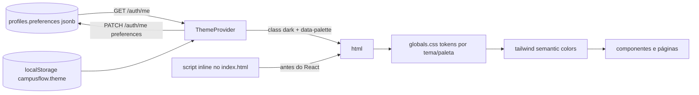

# Sprint 3 — Autogestão de Perfil, Temas e Refinamento de UI

> Prioridade: **Média / Baixa**. Fonte: relatório de análise funcional do CampusFlow, seção 6 (roadmap) e tabela 4.3 ("Perfil e UI/UX").
> Pressupõe Sprints 1 e 2 concluídas (em especial: `TopNav`, `Drawer`, `PATCH /auth/me`, `AvatarUploader`, card de Integrações Outlook e `VisitTimeHeader`).

## Sumário

1. [Objetivo e escopo](#1-objetivo-e-escopo)
2. [Estado atual do código (achados)](#2-estado-atual-do-código-achados)
3. [Pré-requisitos e convenções](#3-pré-requisitos-e-convenções)
4. [E1 — Tela "Meu perfil" do professor com dados cadastrais](#4-e1--meu-perfil-do-professor-com-dados-cadastrais)
5. [E2 — Refinamento estético do painel docente](#5-e2--refinamento-estético-do-painel-docente)
6. [E3 — Sistema de temas (Claro/Escuro) e paletas de cores](#6-e3--sistema-de-temas-e-paletas)
7. [Ordem de execução sugerida](#7-ordem-de-execução-sugerida)
8. [Checklist de encerramento da sprint](#8-checklist-de-encerramento-da-sprint)
9. [Riscos e decisões em aberto](#9-riscos-e-decisões-em-aberto)

---

## 1. Objetivo e escopo

- Professor edita os próprios **dados cadastrais** (nome, telefone, foto, senha) e as preferências de atuação numa tela "Meu perfil" reorganizada em cards.
- **Refinamento visual** completo do painel docente: tipografia, espaçamento, hierarquia, estados de carregamento/vazio e responsividade.
- **Temas**: alternância Claro/Escuro (com opção "Sistema") e escolha de paleta de cores, persistidas por usuário, aplicadas a todo o app sem flash de tema errado.

Fora do escopo: novas regras de negócio, novas integrações.

---

## 2. Estado atual do código (achados)

### Perfil e autoatendimento

- [apps/web/src/features/profiles/ProfilePages.tsx](../../apps/web/src/features/profiles/ProfilePages.tsx) `ProfessorProfilePage`: cursos (chips), temas (`topics`), `acceptsVisits`, `isSubstitute`; salva em `PUT /professors/me/profile` ([professors.routes.ts](../../apps/api/src/modules/professors/professors.routes.ts)); `area` é derivada dos nomes dos cursos no save.
- `updateProfessorProfileSchema` em [promoters.schemas.ts](../../apps/api/src/modules/promoters/promoters.schemas.ts) (~32–38): `area, topics, acceptsVisits, isSubstitute, courseIds`.
- `GET /auth/me` ([auth.service.ts](../../apps/api/src/modules/auth/auth.service.ts) ~10–39): `profile { id, tenant_id, full_name, email, phone, role, avatar_url, is_active }, tenant, campuses, courseIds, courses`. Tipo `AuthMe` em [AuthProvider.tsx](../../apps/web/src/features/auth/AuthProvider.tsx) ~11–31.
- `PATCH /auth/me` (nome, telefone, data de nascimento, avatar) e `AvatarUploader` são entregues na **Sprint 1 (E5)**; se ainda não existirem, criá-los aqui seguindo aquele plano.
- Troca de senha: não existe; o web usa `supabase.auth` ([apps/web/src/lib/supabase](../../apps/web/src/lib/supabase.ts)), então `supabase.auth.updateUser({ password })` resolve no cliente sem rota nova.
- Troca de e-mail: `supabase.auth.updateUser({ email })` dispara confirmação por e-mail; `profiles.email` precisaria ser sincronizado (trigger em `auth.users` ou atualização após confirmação). Tratar como opcional.

### Painel docente (telas do professor)

- Rotas em [router.tsx](../../apps/web/src/app/router.tsx): `/app/solicitacoes` → [InvitationsPage.tsx](../../apps/web/src/features/invitations/InvitationsPage.tsx) (título "Solicitações"); `/app/minhas-visitas` → `MyVisitsPage`; `/app/minhas-visitas/:id` → `VisitBriefingPage` ([VisitsPages.tsx](../../apps/web/src/features/visits/VisitsPages.tsx)); `/app/disponibilidade` → [AvailabilityPage.tsx](../../apps/web/src/features/availability/AvailabilityPage.tsx); `/app/meu-perfil` → `ProfileRoute`.
- Estados de carregamento usam `<Spinner />` de página inteira; `Skeleton` existe em `components/ui` mas é pouco usado. `EmptyState` existe.
- `AvailabilityPage` edita regras por formulário simples (dia, início, fim), sem visualização em grade semanal.
- Componentes de UI concentrados em [apps/web/src/components/ui/index.tsx](../../apps/web/src/components/ui/index.tsx) (`Button, Input, Textarea, Select, Label, FieldError, Card, Badge, EmptyState, Skeleton, ScoreBar, Stepper, PageHeader, Spinner` + `Drawer`, `BackButton` das sprints anteriores). Cores hardcoded em classes `slate-*`, `brand-*`, `white`.

### Tema

- [apps/web/tailwind.config.ts](../../apps/web/tailwind.config.ts): `darkMode: 'class'` já habilitado; paleta `brand` 50–900 (azul fixo); fonte Inter.
- [apps/web/src/styles/globals.css](../../apps/web/src/styles/globals.css): só `@tailwind` + `body { @apply bg-slate-50 text-slate-900 }`. **Sem CSS variables**.
- `grep 'dark:'` em `apps/web/src` → **0 ocorrências**. Nenhum `ThemeProvider` (apenas citado como futuro em `apps/web/src/app/README.md`).
- `recharts` já é dependência (usado no Dashboard) com cores fixas em hex.
- Não há coluna de preferências do usuário em `profiles`; `tenants` possui configurações de branding? Verificar em [0003_tenancy.sql](../../supabase/migrations/0003_tenancy.sql) antes de decidir paleta por tenant.

---

## 3. Pré-requisitos e convenções

- Sprints 1 e 2 aplicadas; próxima migração **`0024`**.
- Decisões de design a fechar antes de começar (ver seção 9): tokens de cor, paletas oferecidas, escala tipográfica.
- Validar sempre com `npm run typecheck --workspace @campusflow/web` e navegação manual nos três papéis, em claro e escuro, desktop e mobile.
- Toda cor nova deve vir de **token semântico** (`bg-surface`, `text-fg`, `border-border`, `bg-brand`), nunca de `slate-*`/hex direto, para o tema funcionar.

---

## 4. E1 — "Meu perfil" do professor com dados cadastrais

### Objetivo

Página `/app/meu-perfil` do professor reorganizada em cards: **Dados pessoais**, **Atuação acadêmica**, **Preferências de visita**, **Integrações** (Outlook, Sprint 2), **Segurança** e **Aparência** (E3). Edição com validação, feedback e sem recarregar a página.

### Arquivos

- [apps/api/src/modules/auth/auth.routes.ts](../../apps/api/src/modules/auth/auth.routes.ts), `auth.schemas.ts`, `auth.service.ts` (`PATCH /auth/me` — ampliar se necessário)
- [packages/shared/src/schemas.ts](../../packages/shared/src/schemas.ts) (`updateMeSchema`, `phoneSchema`)
- [apps/web/src/features/profiles/ProfilePages.tsx](../../apps/web/src/features/profiles/ProfilePages.tsx) → dividir em `features/profiles/professor/` (`ProfessorProfilePage.tsx`, `PersonalDataCard.tsx`, `AcademicCard.tsx`, `PreferencesCard.tsx`, `SecurityCard.tsx`) + `features/profiles/shared/` (`AvatarUploader.tsx`, `ProfileLayout.tsx`)
- [apps/web/src/features/auth/AuthProvider.tsx](../../apps/web/src/features/auth/AuthProvider.tsx) (expor `refreshMe()`)

### Passos

1. **Shared**: `updateMeSchema = z.object({ fullName: z.string().trim().min(3).max(120).optional(), phone: phoneSchema.optional().nullable(), birthDate: birthDateSchema.optional(), avatarUrl: z.string().url().nullable().optional() })`. Reutilizar `maskPhoneBr/unmaskDigits` de [format.ts](../../apps/web/src/lib/format.ts) no front.
2. **API `PATCH /auth/me`**: garantir que aceita todos os campos acima para qualquer papel, atualiza `profiles` com o client do usuário (política `profiles_update_self`) e devolve o `me` completo (`getMe`). Rejeitar alteração de `role`, `tenant_id`, `email`, `is_active`.
3. **`ProfileLayout`**: cabeçalho com avatar grande, nome, papel e chips de status (ex.: "Aceita visitas", "Outlook conectado"); navegação por âncoras/abas entre os cards em telas largas (`md:grid-cols-[220px_1fr]`), empilhado no mobile.
4. **`PersonalDataCard`**: formulário RHF + zod (`updateMeSchema`): nome, telefone (máscara), foto (`AvatarUploader`), e-mail somente leitura com texto "para alterar, fale com a administração" (ou fluxo opcional via `supabase.auth.updateUser({ email })`). Botão Salvar habilitado só com `isDirty`; toast de sucesso; `refreshMe()`.
5. **`AcademicCard`**: cursos (chips multi-select já existentes), temas (`topics` como tags com Enter/vírgula), campo "Área" opcional de texto curto se o time quiser além da derivação por cursos. Persiste em `PUT /professors/me/profile`.
6. **`PreferencesCard`**: `acceptsVisits`, `isSubstitute` como switches com descrição clara do impacto ("Você aparece para visitas de alunos interessados nos seus cursos"). Persiste no mesmo endpoint.
7. **`SecurityCard`**: nova senha + confirmação (mín. 8, 1 letra, 1 número) → `supabase.auth.updateUser({ password })`; exibir "Última sessão iniciada em …" se disponível; botão "Sair de todos os dispositivos" (`supabase.auth.signOut({ scope: 'global' })`).
8. **Integrações** (Sprint 2) e **Aparência** (E3) entram como cards no mesmo layout.
9. **Promotor**: aplicar o mesmo `ProfileLayout` ao `PromoterProfilePage` (Dados pessoais compartilhados + card "Perfil de promotor" com bio, foco, status de aptidão da Sprint 1). Admin ganha `/app/meu-perfil` com Dados pessoais + Segurança + Aparência (hoje o admin não tem essa rota no `NAV`).
10. **Acessibilidade**: labels associados, mensagens de erro com `aria-describedby`, ordem de tabulação, foco no primeiro erro.

### Validação

- Professor altera nome/telefone/foto → `GET /auth/me` reflete; header `TopNav` atualiza sem reload.
- Senha nova funciona no login; senha fraca é barrada no front e pelo Supabase.
- Tentativa de `PATCH /auth/me` com `role` no body → 422 (campo desconhecido rejeitado pelo `strict()`), com `fullName` de 2 letras → 422.
- Mobile 375 px: cards empilhados sem overflow horizontal.

### Critérios de aceite

- Professor gerencia dados cadastrais, atuação, preferências, senha e foto sem intervenção do admin.
- Mesmo layout de perfil para promotor e admin (consistência).

### Prompt sugerido

> "Implemente o E1 da Sprint 3: amplie PATCH /auth/me com updateMeSchema (shared), reorganize ProfessorProfilePage em ProfileLayout + cards PersonalData/Academic/Preferences/Security, reutilize AvatarUploader, adicione refreshMe no AuthProvider e troca de senha via supabase.auth.updateUser. Aplique o mesmo layout ao perfil do promotor e crie /app/meu-perfil para admin."

---

## 5. E2 — Refinamento estético do painel docente

### Objetivo

Elevar a qualidade visual e de uso das telas do professor (Solicitações, Minhas visitas, Briefing, Disponibilidade, Meu perfil): escala tipográfica consistente, espaçamento, hierarquia, skeletons, estados vazios úteis, responsividade e acessibilidade. As melhorias nos componentes base beneficiam todos os papéis.

### Arquivos

- [apps/web/src/components/ui/index.tsx](../../apps/web/src/components/ui/index.tsx) → dividir em `components/ui/*.tsx` (um componente por arquivo, index re-exportando)
- [apps/web/tailwind.config.ts](../../apps/web/tailwind.config.ts) (escala tipográfica, spacing, radius, shadows)
- [apps/web/src/styles/globals.css](../../apps/web/src/styles/globals.css)
- Telas: [InvitationsPage.tsx](../../apps/web/src/features/invitations/InvitationsPage.tsx), [VisitsPages.tsx](../../apps/web/src/features/visits/VisitsPages.tsx), [AvailabilityPage.tsx](../../apps/web/src/features/availability/AvailabilityPage.tsx), `features/profiles/professor/*` (E1)
- [apps/web/src/app/layouts/TopNav.tsx](../../apps/web/src/app/layouts/TopNav.tsx) e `AppLayout.tsx`

### 5.1 Fundamentos (design tokens)

1. **Tipografia** em `tailwind.config.ts` → `theme.extend.fontSize`: `display (30/36, 700)`, `h1 (24/32, 600)`, `h2 (18/28, 600)`, `body (14/22)`, `small (12/16)`, `label (12/16, 600, tracking-wide uppercase)`. Documentar o uso em `apps/web/src/components/README.md`.
2. **Espaçamento**: padronizar `Card` com `p-5 md:p-6`, gap entre cards `space-y-4`, seções `space-y-8`; container `max-w-6xl` no painel docente (menos largo que o admin).
3. **Raio e sombra**: `rounded-2xl` em cards, `rounded-xl` em inputs/botões, `shadow-sm` padrão e `shadow-md` no hover de cards clicáveis.
4. **Cores**: migrar para tokens semânticos (ver E3) — fazer aqui a troca nos componentes base, para que o E3 só precise definir os valores.
5. **Ícones**: adicionar `lucide-react` (leve, tree-shakeable) para ações e estados (relógio, câmera, calendário, check, alerta). Hoje não há biblioteca de ícones.

### 5.2 Componentes novos/ajustados

- `Section({ title, description, actions, children })`: cabeçalho de seção padronizado.
- `Stat({ label, value, hint, icon })`: para resumo no topo do painel (ex.: "Solicitações pendentes", "Visitas esta semana").
- `Switch` acessível (substitui checkboxes em preferências).
- `Tabs` simples (perfil e disponibilidade).
- `Toast` (provider leve em `app/`): hoje o feedback é texto inline; um toast único e consistente melhora as telas de edição.
- `Skeleton` com variantes `SkeletonCard`, `SkeletonList(rows)`; substituir `Spinner` de página inteira por skeletons nas cinco telas do professor.
- `EmptyState` com ilustração opcional (SVG inline) e ação primária.
- `Badge`: tamanhos `sm/md`, variante com ponto colorido, e mapa de cores por status usando tokens.
- `Button`: tamanhos `sm/md/lg`, estado `loading` com spinner embutido, `iconLeft/iconRight`.

### 5.3 Telas do professor

1. **Solicitações** (`InvitationsPage`): topo com `Stat`s; cards com `VisitTimeHeader` (Sprint 2), candidato, curso, foco, resumo colapsável ("ver mais"), barra de tempo restante; botões Aceitar (primário) / Recusar (secundário) com motivo em `Drawer`; skeleton durante o poll inicial; estado vazio "Nenhuma solicitação — você será avisado por e-mail".
2. **Minhas visitas** (`MyVisitsPage` para professor): segmentação "Próximas / Realizadas"; agrupamento por dia com cabeçalhos sticky; card compacto com horário, candidato, promotor, status; ação "Ver briefing".
3. **Briefing** (`VisitBriefingPage`): layout em duas colunas no desktop (resumo do candidato à esquerda; roteiro, equipe e fotos à direita), uma coluna no mobile; tipografia legível para uso no celular durante o tour (mín. 16 px no corpo); botão "Adicionar ao calendário" (ICS já existe em `GET /calendar/events/:id/ics`) quando não houver Outlook.
4. **Disponibilidade** (`AvailabilityPage`): grade semanal visual (7 colunas × horas) para marcar/desmarcar blocos com clique e arraste, convertendo em `availability_rules`; lista de bloqueios (manuais e Outlook) ao lado; botão "Gerar horários (30 dias)" com resultado em toast. Manter o formulário simples como alternativa acessível.
5. **Meu perfil**: entregue no E1 com os componentes daqui.
6. **Navegação do professor** (`TopNav`): ordem Solicitações · Minhas visitas · Disponibilidade · Meu perfil; contador de solicitações pendentes no item (poll já existe na página; extrair hook `usePendingInvitationsCount`).

### 5.4 Responsividade e acessibilidade

- Breakpoints testados: 360, 768, 1024, 1440.
- Alvos de toque ≥ 44 px; contraste AA (verificar com os tokens do E3 em claro e escuro).
- `prefers-reduced-motion` respeitado nas transições de Drawer/Toast.
- Navegação por teclado completa nas novas grades (disponibilidade) com instruções textuais alternativas.

### Validação

- Revisão visual lado a lado (antes/depois) nas cinco telas, nos quatro breakpoints, claro e escuro.
- Lighthouse (aba Accessibility) ≥ 95 nas telas do professor.
- Typecheck e navegação completa como professor sem erros no console.

### Critérios de aceite

- Painel docente coeso: mesma escala tipográfica, espaçamento e componentes em todas as telas.
- Nenhum `Spinner` de página inteira nas telas do professor; skeletons e estados vazios com ação.
- Disponibilidade editável em grade visual.

### Prompt sugerido

> "Implemente o E2 da Sprint 3 em duas fases: (1) fundamentos — tokens de tipografia/spacing no tailwind.config, split de components/ui em arquivos, novos componentes Section, Stat, Switch, Tabs, Toast, SkeletonCard/List, Button com loading, ícones lucide-react; (2) telas — InvitationsPage, MyVisitsPage (professor), VisitBriefingPage, AvailabilityPage com grade semanal, contador no TopNav. Valide em 360/768/1024/1440 px."

---

## 6. E3 — Sistema de temas e paletas

### Objetivo

Tema **Claro / Escuro / Sistema** e **paleta de cores** selecionáveis pelo usuário, aplicados a todo o app (inclusive gráficos), sem flash ao carregar, persistidos localmente e na conta.

### Arquitetura



### Arquivos

- Migração `supabase/migrations/0024_profile_preferences.sql`
- `apps/api/src/modules/auth/*` (`preferences` em `updateMeSchema` e `getMe`)
- [apps/web/index.html](../../apps/web/index.html) (script anti-flash)
- [apps/web/src/styles/globals.css](../../apps/web/src/styles/globals.css) (tokens)
- [apps/web/tailwind.config.ts](../../apps/web/tailwind.config.ts) (cores semânticas via CSS vars)
- Novo `apps/web/src/app/theme/ThemeProvider.tsx`, `theme.ts` (tipos/paletas), `useTheme.ts`
- [apps/web/src/app/layouts/TopNav.tsx](../../apps/web/src/app/layouts/TopNav.tsx) (toggle rápido)
- `features/profiles/shared/AppearanceCard.tsx` (E1)
- [apps/web/src/features/dashboard/DashboardPage.tsx](../../apps/web/src/features/dashboard/DashboardPage.tsx) (cores do recharts via tokens)
- Todas as páginas/componentes com cores hardcoded (migração gradual)

### 6.1 Banco e API

```sql
-- 0024_profile_preferences.sql
alter table public.profiles add column if not exists preferences jsonb not null default '{}'::jsonb;
-- exemplo: {"theme":"dark","palette":"emerald","density":"comfortable"}
```

- `updateMeSchema`: `preferences: z.object({ theme: z.enum(['light','dark','system']).optional(), palette: z.enum(PALETTES).optional() }).strict().optional()`; o service faz merge (`preferences = preferences || $1`).
- `getMe` devolve `profile.preferences`.

### 6.2 Tokens CSS (`globals.css`)

```css
:root {
  --bg: 248 250 252;        /* slate-50 */
  --surface: 255 255 255;
  --surface-2: 241 245 249; /* slate-100 */
  --fg: 15 23 42;           /* slate-900 */
  --fg-muted: 71 85 105;    /* slate-600 */
  --border: 226 232 240;    /* slate-200 */
  --ring: var(--brand-500);
  --success: 22 163 74; --warning: 217 119 6; --danger: 225 29 72; --info: 2 132 199;
}
.dark {
  --bg: 2 6 23; --surface: 15 23 42; --surface-2: 30 41 59;
  --fg: 241 245 249; --fg-muted: 148 163 184; --border: 51 65 85;
}
[data-palette="blue"]    { --brand-50: 239 246 255; --brand-500: 59 130 246; --brand-600: 37 99 235; --brand-700: 29 78 216; }
[data-palette="emerald"] { --brand-50: 236 253 245; --brand-500: 16 185 129; --brand-600: 5 150 105; --brand-700: 4 120 87; }
[data-palette="violet"]  { --brand-50: 245 243 255; --brand-500: 139 92 246; --brand-600: 124 58 237; --brand-700: 109 40 217; }
[data-palette="amber"]   { --brand-50: 255 251 235; --brand-500: 245 158 11; --brand-600: 217 119 6; --brand-700: 180 83 9; }
body { @apply bg-bg text-fg antialiased; }
```

(definir a escala completa 50–900 de cada paleta; em `.dark` ajustar `--brand-50/100` para tons escuros translúcidos, pois são usados como fundo de estados ativos).

### 6.3 Tailwind

```ts
// tailwind.config.ts → theme.extend.colors
const v = (name: string) => `rgb(var(--${name}) / <alpha-value>)`;
colors: {
  bg: v('bg'), surface: v('surface'), 'surface-2': v('surface-2'),
  fg: v('fg'), 'fg-muted': v('fg-muted'), border: v('border'), ring: v('ring'),
  success: v('success'), warning: v('warning'), danger: v('danger'), info: v('info'),
  brand: { 50: v('brand-50'), 100: v('brand-100'), /* … */ 900: v('brand-900') },
}
```

Manter `darkMode: 'class'`. Como `brand` passa a ser variável, **todas** as classes `brand-*` existentes já seguem a paleta sem alteração.

### 6.4 `ThemeProvider`

1. `theme.ts`: `type ThemeMode = 'light' | 'dark' | 'system'`; `PALETTES = ['blue','emerald','violet','amber'] as const`; `STORAGE_KEY = 'campusflow.theme'`.
2. `ThemeProvider`: estado `{ mode, palette }`; resolve `system` com `matchMedia('(prefers-color-scheme: dark)')` e escuta mudanças; aplica `document.documentElement.classList.toggle('dark', resolved === 'dark')` e `dataset.palette = palette`; salva em `localStorage`; quando `me` carregar, se `me.profile.preferences` tiver valores, eles **prevalecem** e sobrescrevem o localStorage; `setTheme`/`setPalette` chamam `PATCH /auth/me { preferences }` (debounce 500 ms) quando autenticado.
3. Montar no `main.tsx` fora do `RequireAuth` (tema também vale no login e no portal do candidato; nesse caso só localStorage).
4. **Anti-flash**: em `index.html`, antes do bundle:
   ```html
   <script>
     try {
       var t = JSON.parse(localStorage.getItem('campusflow.theme') || '{}');
       var dark = t.mode === 'dark' || (t.mode !== 'light' && matchMedia('(prefers-color-scheme: dark)').matches);
       document.documentElement.classList.toggle('dark', dark);
       document.documentElement.dataset.palette = t.palette || 'blue';
     } catch (e) {}
   </script>
   ```
   e `<meta name="color-scheme" content="light dark">`; atualizar `theme-color` do manifesto PWA dinamicamente no provider.
5. `useTheme()` expõe `{ mode, resolved, palette, setMode, setPalette }`.

### 6.5 UI

1. **Toggle rápido no `TopNav`**: botão sol/lua (cicla claro → escuro → sistema, com tooltip) visível em todos os papéis.
2. **`AppearanceCard`** no perfil: segmented control Claro / Escuro / Sistema com pré-visualização; grade de paletas (círculos de cor com nome e `aria-label`); opcional "Densidade" (confortável/compacta) ajustando `--space-unit`.
3. **Migração das cores**: substituir em `components/ui/*` e páginas: `bg-white → bg-surface`, `bg-slate-50 → bg-bg` ou `bg-surface-2`, `text-slate-900 → text-fg`, `text-slate-500/600 → text-fg-muted`, `border-slate-200/100 → border-border`, `bg-slate-950` (blocos de código) → `bg-surface-2 dark:bg-black/40`. Fazer por busca/substituição guiada (`rg "slate-" apps/web/src`) e revisar manualmente os casos de contraste (badges de status: usar `bg-success/15 text-success` etc.).
4. **Gráficos** (`DashboardPage`): ler as cores em runtime com `getComputedStyle(document.documentElement).getPropertyValue('--brand-600')` num hook `useChartColors()` que reage ao tema; `CartesianGrid`/eixos com `--border`/`--fg-muted`; `Tooltip` com `contentStyle` usando tokens.
5. **Calendários e Drawer**: revisar estados "hoje", "selecionado", overlay (`bg-black/50` no escuro).
6. **Imagens/logos**: logo com variante para fundo escuro se houver asset; favicons neutros.
7. **Portal do candidato e landing** (`PublicLayout`): aplicar tokens também, respeitando o tema do sistema (sem seletor obrigatório).

### 6.6 Paleta por tenant (opcional)

Se `tenants` tiver branding (verificar coluna/JSON em `0003_tenancy.sql`), o admin pode definir a paleta padrão do tenant em Configurações; o usuário ainda pode sobrescrever. Expor `tenant.branding.palette` em `GET /auth/me` e usar como fallback no `ThemeProvider`.

### Validação

- Alternar tema no `TopNav`: todo o app muda sem reload; recarregar a página não exibe flash; abrir em outra aba mantém a escolha; logar em outro navegador aplica a preferência salva na conta.
- "Sistema" segue a mudança do SO em tempo real.
- Trocar paleta altera botões, links, estados ativos, gráficos e badges.
- Contraste AA verificado (ex.: axe DevTools) em claro e escuro nas telas principais dos três papéis e no portal do candidato.
- `rg "slate-|bg-white|#[0-9a-fA-F]{6}" apps/web/src` retorna apenas exceções justificadas (documentadas no README de componentes).

### Critérios de aceite

- Claro/Escuro/Sistema + 4 paletas funcionando em 100% das telas, sem flash, persistidos por usuário.
- Nenhum componente base com cor hardcoded.

### Prompt sugerido

> "Implemente o E3 da Sprint 3: migração 0024 (profiles.preferences), preferences em PATCH /auth/me e getMe, tokens CSS em globals.css, cores semânticas via CSS vars no tailwind.config, ThemeProvider com modo/paleta e persistência (localStorage + conta), script anti-flash no index.html, toggle no TopNav, AppearanceCard no perfil, migração das classes slate/white para tokens e cores dos gráficos via useChartColors."

---

## 7. Ordem de execução sugerida

1. **E3 — fundamentos de tema primeiro (6.1 a 6.4)**: definir tokens e `ThemeProvider` antes de refinar telas evita retrabalho de cores. (1 dia)
2. **E2 — fundamentos de UI (5.1 e 5.2)** usando os tokens: componentes base, ícones, toast, skeletons. (1,5 dia)
3. **E1 — Meu perfil** com os novos componentes (inclui `AppearanceCard`). (1,5 dia)
4. **E2 — telas do professor (5.3 e 5.4)**: Solicitações, Minhas visitas, Briefing, Disponibilidade em grade. (2–3 dias)
5. **E3 — migração completa de cores (6.5.3 em diante)** e verificação de contraste em todo o app, incluindo admin, promotor e portal. (1 dia)

---

## 8. Checklist de encerramento da sprint

- [ ] `PATCH /auth/me` com nome, telefone, foto, data de nascimento e `preferences`; `getMe` devolve `preferences`.
- [ ] Meu perfil do professor em cards (dados pessoais, atuação, preferências, integrações, segurança, aparência); troca de senha funcional; mesmo layout para promotor e admin.
- [ ] Tokens de tipografia/espaçamento/cores documentados em `apps/web/src/components/README.md`; `components/ui` dividido por arquivo.
- [ ] Novos componentes: `Section`, `Stat`, `Switch`, `Tabs`, `Toast`, skeletons, `Button` com loading, ícones.
- [ ] Telas do professor refinadas e responsivas; disponibilidade em grade semanal; contador de solicitações no menu.
- [ ] Tema Claro/Escuro/Sistema e paletas com persistência por usuário, sem flash, gráficos incluídos.
- [ ] Zero cores hardcoded nos componentes base; auditoria de contraste AA concluída.
- [ ] READMEs de `apps/web/src/app`, `components` e `features/profiles` atualizados; `npm run db:status` mostra 0024 aplicada.

---

## 9. Riscos e decisões em aberto

- **Quais paletas oferecer**: proposta de 4 (azul padrão, esmeralda, violeta, âmbar). Confirmar com o time de design se há identidade visual da Mauá a respeitar (nesse caso, a paleta institucional deve ser a padrão do tenant).
- **Preferência por usuário vs. por tenant**: o plano implementa por usuário com fallback opcional por tenant; definir se o admin pode travar a paleta.
- **Troca de e-mail**: envolve confirmação do Supabase e sincronização de `profiles.email`; mantida como opcional/fora do padrão desta sprint.
- **Migração de cores em massa**: risco de regressões visuais em telas do admin/promotor; fazer por módulo com revisão visual, e manter um PR separado para a substituição mecânica.
- **Grade de disponibilidade com arraste**: implementação própria (sem lib) para manter o bundle leve; se o prazo apertar, entregar clique por célula e deixar o arraste como melhoria.
- **Biblioteca de ícones**: `lucide-react` adiciona dependência; alternativa é SVG inline para os ~15 ícones necessários.
- **PWA / `theme-color`**: o manifesto é estático; atualizar a meta tag em runtime cobre a barra do navegador, mas o splash do PWA instalado seguirá o manifesto.
